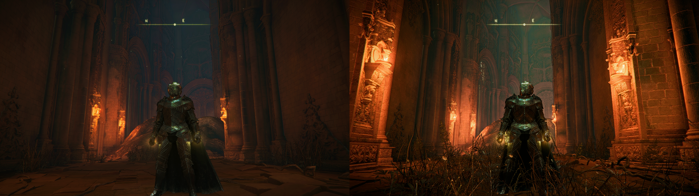
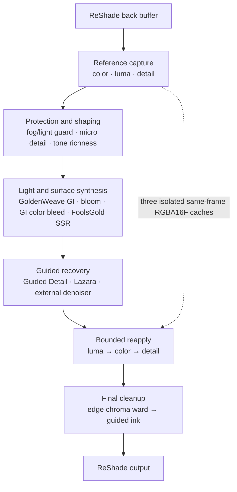

# Lazara ReShade Revival Package

**Color revival. Detail revival. Controlled.**

Lazara is a ReShade preset and curated effect package for scenes that lose
color separation, tonal presence, and readable surface detail under adverse
conditions. Its ordered chain guards difficult fog and light, revives
chromatic and tonal structure, captures color, luma, and reference detail
before intervening effects, and reapplies each signal under independent limits
later in the same frame.

This is not a blanket saturation pass or an attempt to invent detail that was
never present. Lazara is built to make existing color legible again and
existing detail present again—deliberately, inspectably, and with direct
before/after evidence.

## For Lis — wake lazara there is another life to live

## Featuring [FlexAgX](https://github.com/El-Greco1541/FlexAgX)


Featuring [FlexAgX by El-Greco1541](https://github.com/El-Greco1541/FlexAgX).
The two supplied views are presented in attachment order at native resolution.
This is a showcase credit and link; FlexAgX is not peddled in this package.

### Lazara and Twin Lanterns two-way comparison



Left: supplied `Lazara-Twin-Lantern` capture. Right: supplied
`BASEReFlexAgX-Lazara-Twin-Lantern` capture. Both complete 2560×1440 frames are
presented at native resolution. Because their camera framing differs, this is
presentation evidence rather than a registered per-pixel A/B or proof that
isolates the contribution of one effect. Source hashes and exact decoded-pixel
validation are recorded in [`docs/images/README.md`](docs/images/README.md).


The snow-fortress comparison uses Image 1 as OFF and Image 2 as ON. The left
panel is ON-left/OFF-right; the right panel is OFF-left/ON-right, exposing both
halves of both source images for side-by-side inspection.

## What Lazara revives

### Color under pressure

Lazara treats color as structure, not decoration. Its technique order combines
fog/light guarding, tone-detail richness, GI color bleed, bloom treatment, and an
edge chroma ward so that muted or hostile scenes can recover separation and
presence without reducing the package to a single saturation slider.

### Color, luma, and detail with a reference

Three independent Camera Obscura cache pairs capture relative chroma, Rec. 709
luma, and selected signed reference detail. They hold those signals through
the intervening color and lighting work, then reapply each one at its own point
and under its own limits. The result is revival tied to the actual source
frame—not free-floating saturation, sharpening, or fabricated texture.

### One deliberate chain

The preset coordinates 18 enabled techniques across 15 effect files. Color,
light, denoising, guided detail, and final edge treatment are ordered as one
reproducible image path rather than a loose pile of effects.

## Architecture

Lazara is an ordered frame graph. [`Lazara.ini`](Lazara.ini) establishes the
runtime sequence, and [`tools/validate_package.ps1`](tools/validate_package.ps1)
locks that sequence as part of package validation. Three cache effect files
each expose a capture and a reapply technique, which is why 18 techniques are
implemented by 15 effect files.

### Runtime dataflow



The capture techniques write reference textures and do not change the
displayed image. The visible back buffer continues through the intervening
stack; the cached signals return only at their explicit reapply points.

### Accepted technique order

| Positions | Phase | Techniques | Responsibility |
|---:|---|---|---|
| 1–3 | Reference capture | `StabilizedColorCapture`, `StabilizedLumaCapture`, `StabilizedDetailCapture` | Record source-relative chroma, Rec. 709 luma, and signed local detail before the image is reshaped. |
| 4–6 | Protection and shaping | `FogLight_Guard`, `MicroDetail_Clarity`, `ToneDetail_Richness` | Protect difficult fog/light regions and establish fine-detail and tone structure. |
| 7–10 | Light and surface synthesis | `GoldenWeave_RMGI_Redux`, `BloomBurst_Corona`, `GI_ColorBleed`, `FoolsGold` | Apply screen-space GI, controlled bloom, color bleed, and layered screen-space reflections. |
| 11–13 | Guided recovery | `GuidedDetailReclamation`, `OCCULT_lazara`, `ExternalImageDenoiseV1` | Recover supported detail and observed color, then reduce source-domain spatial/temporal noise. |
| 14–16 | Bounded reapply | `StabilizedLumaReapply`, `StabilizedColorReapply`, `StabilizedDetailReapply` | Restore only the captured signals, in luma→color→detail order, under independent limits. |
| 17–18 | Final cleanup | `EdgeChromaWard`, `GuidedInkLines` | Remove thin color fringes and apply the final stable, same-surface line treatment. |

The table describes the supplied preset, not a claim that every stage is
universally required. Reordering capture/reapply stages changes their reference
contract and is therefore an architectural change, not a cosmetic preference.

### Three isolated same-frame caches

The default build allocates three full-resolution `RGBA16F` textures. Each
cache stores a frame stamp in alpha, and each reapply pass requires that stamp
to match the current frame. A stale, missing, disabled, or first-frame capture
has zero authority, so the reapply path returns the current source unchanged.

1. `CAMERA_OBSCURA_StabilizedColorCaptureV1` stores source chroma relative to
   source luma. `CAMERA_OBSCURA_StabilizedColorReapplyV1` moves current chroma
   toward that reference while preserving current luma.
2. `CAMERA_OBSCURA_StabilizedLumaCaptureV1` stores Rec. 709 luma.
   `CAMERA_OBSCURA_StabilizedLumaReapplyV1` restores a bounded scalar luma
   difference while retaining the current RGB channel separation.
3. `CAMERA_OBSCURA_StabilizedDetailCaptureV1` extracts a color- and
   depth-aware signed residual from a local base.
   `CAMERA_OBSCURA_StabilizedDetailReapplyV1` adds that residual back under an
   independent signed per-channel limit.

This is GPU memory used within the running ReShade pipeline. It is not a disk
cache, saved history, or cross-session learning system.

### Containment and failure behavior

| Component | Containment rule | Failure behavior |
|---|---|---|
| Color cache | Luma floor, stored relative-chroma limit, applied-delta limit, zero-luma projection, and gamut fit | Stale or disabled cache contributes no correction. |
| Luma cache | Applied scalar limit plus per-channel headroom before output saturation | Stale or disabled cache contributes no correction. |
| Detail cache | Color/depth support, capture threshold, stored limit, reapply limit, and final gamut clamp | Stale or disabled cache contributes no detail. |
| External denoiser | Multiscale noise targets, local-range clamps, history matching, residual rejection, and independent spatial/temporal authority | Invalid history removes temporal authority; the spatial path remains separately bounded. |

The external denoiser owns its own source and denoised history textures. It is
a source-domain cleanup stage for the already composed image; it does not
perform ray traversal, donor transport, reconstruction, or additive GI.

### Runtime and repository boundaries

```text
Lazara.ini                                  ordered preset
reshade-shaders/Shaders/
|-- camera_obscura_external/               directly published denoiser
|-- camera_obscura_reapply/                directly published color/luma caches
|-- camera_obscura_detail_cache/           directly published detail cache
`-- vendor/
    |-- lazara/                            pinned Lazara color-revival closure
    |-- occult_box/                        pinned BlackWand, GoldenWeave, FoolsGold closure
    `-- guided_detail/                     pinned Guided Detail and Guided Ink closure

docs/, tools/, packaging/                  evidence, validation, and distribution only
ReShade.fxh                                external framework dependency
```

Only `Lazara.ini` and the shader tree participate in the runtime image path.
The dependency registry, source lock, manifests, screenshot ledger, builders,
and validators make that path reproducible and inspectable; they do not run as
ReShade effects.

This repository is the temporary standalone installation surface while the
OpenSurface storefront is being finished.

> [!IMPORTANT]
> **Distribution status: perfunctive peddling.** All peddled files are
> presented as play-pretend staging for installation convenience, fun, and
> profitless humour. This is non-transactional and non-monetary; full terms and
> evidence boundaries appear below.

The package contains:

- the `Lazara.ini` preset;
- all 15 effect files enabled by the preset;
- the complete local header closure required by those effects;
- the Camera Obscura External Image Denoiser and independent Stabilized Color,
  Luma, and Detail caches;
- pinned temporary copies of Lazara, Occult Box, and Guided Detail source;
- on/off and stack comparison images, hashes, and reproducible stitch builders.

`ReShade.fxh` remains an external dependency supplied by ReShade. This package
does not replace it.

## Earlier full-frame comparisons


The castle scene is Set 1 and the eclipse scene is Set 2. In both rows, OFF is
on the left and ON is on the right. Native-resolution source images, hashes,
and rebuild instructions are recorded in
[`docs/images/README.md`](docs/images/README.md).

## Install

No submodules or secondary repository downloads are required.

1. Download this repository as a ZIP, or clone it normally.
2. Copy `reshade-shaders` into the game directory and merge it with the
   existing `reshade-shaders` directory.
3. Copy `Lazara.ini` beside the game executable, or select it through ReShade's
   preset browser.
4. In ReShade, keep the standard recursive effect search path:

   ```text
   .\reshade-shaders\Shaders\**
   ```

5. Select `Lazara.ini` and reload effects.

Keep the installation's current `ReShade.fxh`. The package intentionally does
not include or overwrite that framework file.

## Perfunctive peddling and evidence boundary

The storefront source repositories remain authoritative. For installation
simplicity, this repository temporarily carries the exact effect/include
closure from three pinned public revisions:

- `dastardlyrat/lazara` at `2c28697a344fb988d784ed31f4d65b107821327b`;
- `dastardlyrat/Occult-Box` at `eef2b91b314ddc1a68547d0fb1daa2413adfce66`;
- `dastardlyrat/OpenSurface-CameraObscura-GuidedDetail` at
  `68850554650abe22cca029a65f7a807b6b3b3047`.

Within this package, **perfunctive peddling** is a deliberately play-pretend
staging convention used for installation convenience, fun, and profitless
humour. It is non-transactional and non-monetary: inclusion of these files does
not represent a sale, purchase, payment, fee, royalty, paid license, or
storefront transaction. The label describes this package's distribution
posture only; it does not change ownership or any underlying license terms.

The complete mapping is in [`DEPENDENCIES.md`](DEPENDENCIES.md), the
machine-readable source lock is [`dependencies.lock.json`](dependencies.lock.json),
and every copied byte is recorded in
[`VENDORED_SHA256SUMS.txt`](VENDORED_SHA256SUMS.txt).

Run the package validator from the repository root:

```powershell
powershell -ExecutionPolicy Bypass -File .\tools\validate_package.ps1
```

Validation establishes the accepted 18-stage order, preset coverage, technique
ownership, the 110-file local include closure, pinned copied bytes, and the
absence of Git submodules. It does not substitute for a new live ReShade
compile, performance pass, or visual acceptance run.

## Licensing

Camera Obscura and Guided Detail files are published under MIT; their license
texts are retained in [`LICENSES`](LICENSES). Lazara and Occult Box do not
currently declare project-wide licenses. Their temporary inclusion here is
owner-authorized source distribution and does not invent or imply broader
license terms. See [`LICENSES/VENDORED-SOURCE-NOTICE.md`](LICENSES/VENDORED-SOURCE-NOTICE.md).
